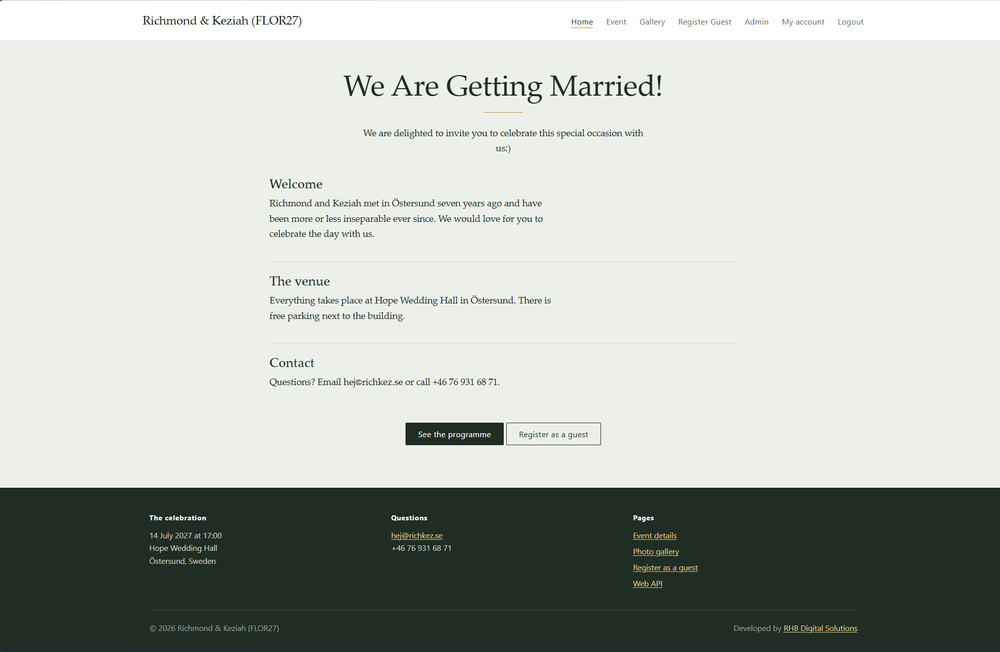
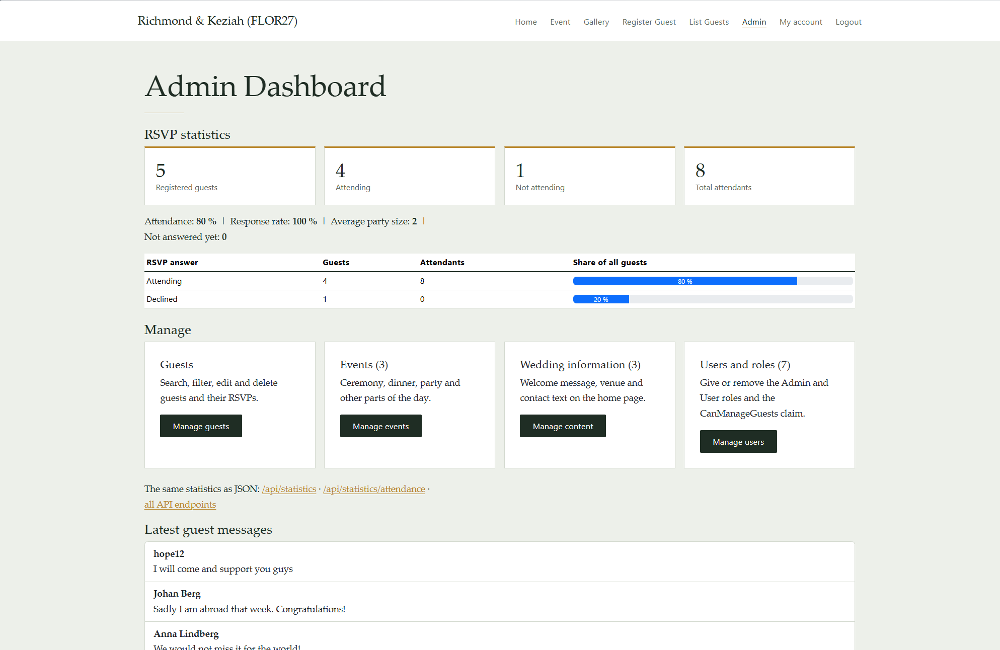

# WeddingAppV3 – Wedding Website Platform V3

Version 3 of the wedding website for Richmond & Keziah, built for **Programming in C#, III – Assignment 3** at Malmö University.

It builds on the ASP.NET Core MVC and Entity Framework Core app from Assignment 2 and adds **Web APIs**, **ASP.NET Core Identity** and **authorization with roles and claims**. Visitors can still read the wedding information, register as guests and answer the RSVP. Admins manage the site from a protected admin area. The same data is also available as JSON through REST endpoints.



## Features

### Public pages
- Home page with the wedding information, edited from the admin area
- Programme of the day (events)
- Photo gallery
- Guest registration followed by the RSVP form

### User accounts (ASP.NET Core Identity)
- Register, log in and log out
- The menu changes depending on whether the user is logged in
- A "My account" page for managing the account

### Admin area (protected)
- Dashboard with RSVP statistics: attendance percentage, response rate, average party size and guests grouped by RSVP answer
- Guest management: search, filter, sort, edit and delete
- Event and wedding information management (create, edit, delete)
- Users and roles page for giving or removing the roles and the `CanManageGuests` claim



### Web API (JSON)
| Endpoint | Description | Access |
|---|---|---|
| `GET /api/events` | All events (`?location=` to search) | Public |
| `GET /api/events/{id}` | One event | Public |
| `GET /api/events/overview` | Short overview (anonymous type) | Public |
| `GET /api/guests/attending` | Names of attending guests (anonymous type) | Public |
| `GET /api/guests` | All guests (`?status=attending\|declined\|noresponse`, `?sort=name\|name_desc\|newest`) | `CanManageGuests` claim |
| `GET /api/guests/{id}` | One guest | `CanManageGuests` claim |
| `GET /api/statistics` | Totals, percentages and averages | Admin role |
| `GET /api/statistics/attendance` | Guests grouped by RSVP answer | Admin role |
| `GET /api/statistics/registrations?page=1&pageSize=5` | Newest registrations, page by page | Admin role |
| `GET /api/statistics/events` | Events grouped by date | Admin role |

The API returns `200 OK`, `400 Bad Request`, `401 Unauthorized`, `403 Forbidden` or `404 Not Found`, with a message where it helps. All endpoints are also listed with clickable links on the page `/Home/Api`.

## Security

| Account type | Can do |
|---|---|
| Visitor (not logged in) | Public pages, guest registration, RSVP, public API endpoints |
| **User** role | Same as a visitor, plus a personal account |
| **CanManageGuests** claim (policy `GuestManager`) | Guest list and the guest API, even without the Admin role |
| **Admin** role | Everything: dashboard, events, wedding information, users and roles, statistics API |

- Role-based authorization: `[Authorize(Roles = "Admin")]`
- Claims-based authorization: `[Authorize(Policy = "GuestManager")]`
- The roles and test accounts are created automatically when the app starts (`Data/SeedData.cs`).

## Technologies

- ASP.NET Core MVC (.NET 9)
- Entity Framework Core 9 with SQLite
- ASP.NET Core Identity (roles and claims)
- Web API controllers (`ControllerBase`, `[ApiController]`)
- LINQ: `Where`, `Select`, `OrderBy`, `OrderByDescending`, `Count`, `Sum`, `Average`, `GroupBy`, `Skip`, `Take`
- ViewModels and anonymous types instead of exposing entities
- A service layer (`StatisticsService`) shared by the MVC and API controllers
- Bootstrap 5

## Project structure

```
WeddingAppV3/
├── Areas/Identity/Pages/   Layout settings for the Identity pages
├── Controllers/            MVC controllers (Home, Guest, Event, Admin, WeddingInfo, Users)
│   └── Api/                API controllers (GuestsApi, EventsApi, StatisticsApi)
├── Data/                   ApplicationDbContext and SeedData
├── Models/                 Entities: Guest, Event, WeddingInfo, ApplicationUser
├── Services/               StatisticsService
├── ViewModels/             Guest, GuestDetails, Event, Dashboard, Statistics, ...
├── Views/                  Razor views and the shared layout
└── wwwroot/                CSS, images and libraries
```

## Getting started

1. Open `WeddingAppV3.sln` in Visual Studio 2022.
2. Open **Tools → NuGet Package Manager → Package Manager Console** and run:
   ```
   Update-Database
   ```
   If the project has no `Migrations` folder, run `Add-Migration InitialCreate` first.
3. Press **F5** to run the application.

The SQLite database `WeddingV3.db` is created in the project folder and filled with sample guests, events and wedding information.

### Test accounts

| Email | Password | Role | Claim |
|---|---|---|---|
| admin@wedding.se | Admin123! | Admin | CanManageGuests |
| planner@wedding.se | Planner123! | User | CanManageGuests |
| user@wedding.se | User123! | User | – |

Roles and claims are stored in the login cookie. After changing a user's roles or claims, that user has to log out and log in again before the change takes effect.

## Author

**Richmond** – Programming in C#, III, Malmö University, 2026
Developed by [RHB Digital Solutions](https://rhbdigital.se)
